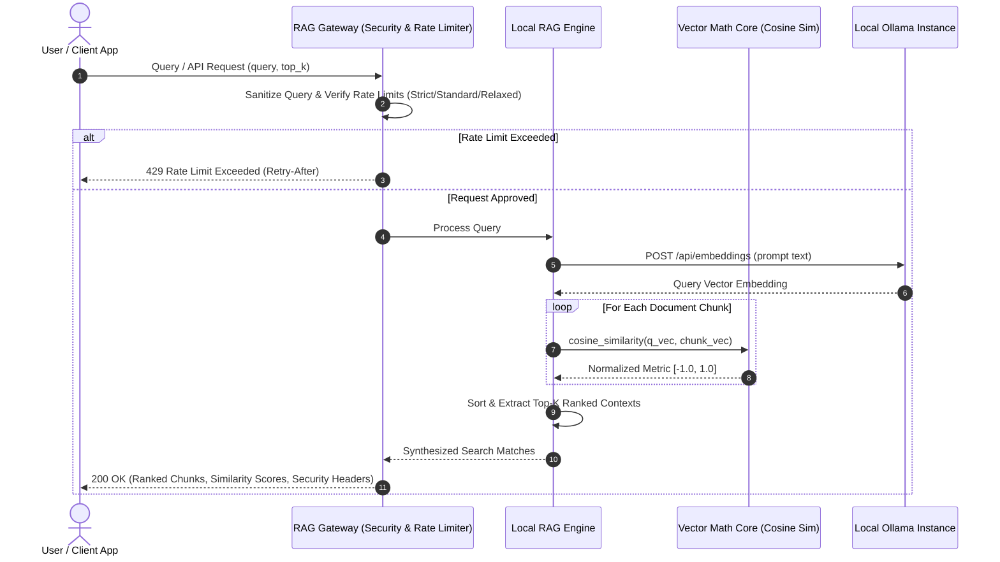

# 🧠 local-rag-mini

[](https://github.com/MobileConduit/local-rag-mini/releases/tag/v1.0.0)
[](LICENSE)
[](https://github.com/MobileConduit)
[](https://ollama.ai)
[](https://github.com/MobileConduit/local-rag-mini/actions)

A lightweight, zero-cloud-cost Retrieval-Augmented Generation (RAG) micro-engine designed for enterprise privacy and offline air-gapped environments. Leverages local Ollama embeddings and pure vector similarity math with configurable rate limiting presets and enterprise security headers.

---

## 🏗️ Architecture & Retrieval Flow

The following Mermaid sequence diagram outlines the document chunking, vector indexing, query sanitization, cosine similarity computation, and context retrieval pipeline:



---

## ⚡ Features

- **Pure Vector Math Engine**: Zero-dependency implementation of Dot Product, Vector Norms, Vector Normalization, Cosine Similarity, and Euclidean Distance.
- **Sliding-Window Rate Limiting**:
  - `strict`: 10 queries/min (edge devices & low-power hardware)
  - `standard`: 30 queries/min (workstation GPU / local Ollama)
  - `relaxed`: 100 queries/min (dedicated enterprise servers)
- **Security & Prompt Defense**: Query sanitization against prompt injection heuristics alongside HTTP security headers (`Content-Security-Policy`, `X-Content-Type-Options: nosniff`, `X-Frame-Options: DENY`, `Strict-Transport-Security`).
- **Flexible Modes**: Native CLI query runner or lightweight HTTP microservice mode (`--serve`).
- **Zero Cloud Cost**: Complete privacy with offline fallback simulation vectors when Ollama is offline.

---

---

## ⚙️ Installation & Setup

```bash
git clone https://github.com/MobileConduit/local-rag-mini.git
cd local-rag-mini
pip install -r requirements.txt
```

## 🚀 Usage

### 1. Configuration
```bash
cp .env.example .env
```

### 2. Local Ollama Models (Optional for live inference)
```bash
ollama pull nomic-embed-text
ollama pull llama3.2
```

### 3. CLI Query Mode
```bash
python rag_engine.py --docs ./company_policies --query "What is the policy regarding remote work and VPN access?" --preset standard
```

### 4. HTTP Microservice Mode
```bash
python rag_engine.py --serve --port 8000 --preset standard
```

Query the API via curl:
```bash
curl -X POST http://localhost:8000 \
  -H "Content-Type: application/json" \
  -d '{"query": "What are the server security policies?", "top_k": 3}'
```

---

## 🧪 Automated Testing

Run the automated test suite verifying vector similarity math, dot products, vector norms, rate limiting, and HTTP security headers:

```bash
python -m unittest discover -s tests -p "test_*.py" -v
```

---

## 👤 Author & Maintainer

**Eng. MHD. Shadi AL-Hasan**  
- **Role:** Executive CTO & Enterprise Solutions Architect  
- **Email:** [mhd.shadi.alhasan@gmail.com](mailto:mhd.shadi.alhasan@gmail.com)  
- **Phone / WhatsApp:** [+963934005922](tel:+963934005922)  
- **Location:** Damascus, Syria  
- **GitHub:** [MobileConduit](https://github.com/MobileConduit)  

---

## 📄 License

This project is licensed under the MIT License - see the [LICENSE](LICENSE) file for details.  
Copyright (c) 2026 **MHD. Shadi AL-Hasan**. All rights reserved.